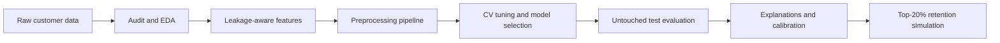

# Customer Churn Risk & Retention Analysis

**A reproducible churn-ranking workflow for a capacity-limited retention team.** The project audits the supplied customer snapshot, trains and explains churn models, and estimates what a top-20% contact list could capture.

| Dataset | Churn prevalence | Model selection | Contact capacity |
|:--|--:|:--|--:|
| 1,200 customers | 86.3% | 4-fold stratified CV, average precision | Top 20% |

> **Holdout snapshot:** Random Forest PR-AUC **0.982**, ROC-AUC **0.890**. The top-risk 20% captured **60 of 259** observed churners (23.2%), versus **51.8** expected from random selection. The unusually high churn prevalence affects interpretation of these scores.

## Project Workflow



## Quick Start

Requires Python 3.10 or newer. Run from the repository root:

```powershell
python -m pip install -r requirements.txt
python src/run_analysis.py
```

The source dataset is bundled at `data/raw/customer_churn_advanced_dataset.csv`. The analysis uses random seed `42`, a stratified 75/25 train/test split, and 4-fold stratified cross-validation. The test set is reserved for final evaluation. The notebook can be run top-to-bottom; `src/run_analysis.py` is the reproducible workflow source.

## Project Files

| Path | Purpose |
|:--|:--|
| [`notebooks/churn_analysis.ipynb`](notebooks/churn_analysis.ipynb) | Executable analysis: audit, EDA, engineering, tuning, evaluation, explanations, and simulation |
| [`data/cleaned_customer_churn.csv`](data/cleaned_customer_churn.csv) | All 1,200 records plus engineered features; original missing values remain visible |
| [`models/churn_model.joblib`](models/churn_model.joblib) | Fitted preprocessing and prediction pipeline, selected threshold, and metadata |
| [`churn_business_report.pdf`](churn_business_report.pdf) | Six-page business report |
| [`reports/figures/`](reports/figures/) | Nine EDA charts and model evaluation figures |
| [`reports/analysis_details.json`](reports/analysis_details.json) | Audit table, model comparison, threshold metrics, importance, local explanations, and test risk ranking |
| `reports/*.json` | Quality checks, final metrics, intervention simulation, robustness, and package versions |
| [`src/run_analysis.py`](src/run_analysis.py) | Reproducible end-to-end workflow |
| [`requirements.txt`](requirements.txt) | Python dependencies |

### Use the Saved Model

Load the pipeline and score a dataframe containing the raw predictor columns. Exclude `customer_id` and `churn`:

```python
import joblib
import math
import pandas as pd

artifact = joblib.load("models/churn_model.joblib")
customers = pd.read_csv("new_customers.csv")
X = customers.drop(columns=["customer_id", "churn"], errors="ignore")
probability = artifact["pipeline"].predict_proba(X)[:, 1]
scored = customers.assign(churn_probability=probability)
top_risk = scored.nlargest(math.ceil(len(scored) * 0.20), "churn_probability")
```

This ranking keeps the contact list to the top 20% of customers. The artifact also stores a cross-validated operating threshold for threshold-based decisions. The serialized feature transformer lives in `src/features.py`; keep that module available when loading the artifact.

## Data & Feature Decisions

The source contains 1,200 rows and 20 columns, with 1,036 churn labels. Missing values occur in monthly charges (30), total charges (24), satisfaction (48), and monthly usage (36). Duplicate rows and IDs, target labels, and plausible numeric ranges are audited. No observations are silently removed. Unusual but plausible charges or usage are retained for review rather than automatically clipped.

Numeric and categorical imputation is fitted inside each training fold. Categorical variables use one-hot encoding, and `customer_id` is excluded from prediction. The cleaned dataset preserves missing values; the model pipeline imputes them during fitting and prediction.

Eight engineered features summarize charge per tenure month, payment risk, complaint intensity, complaint/payment interaction, low satisfaction, charge relative to usage, tenure/charge interaction, and month-to-month contracts. They use customer attributes available at scoring time, not the churn target. Confirm that `total_charges` is available as of the intended scoring date before operational use.

## Modeling & Evaluation

Three classifiers are compared: class-weighted Logistic Regression, class-weighted Random Forest, and HistGradientBoosting. Each has an untuned baseline and a small grid search scored by average precision. The Random Forest was selected on training cross-validation. Class weights address imbalance for the first two models; no resampling is used.

The operating threshold is chosen using training-only out-of-fold predictions to maximize assumed net value subject to the contact-capacity constraint. The test set reports precision, recall, F1, ROC-AUC, PR-AUC, Brier score, confusion matrix, calibration, and fold-to-fold robustness. A separate top-20% ranking simulation measures capacity-based churn capture.

## Business Assumptions & Limits

The illustrative intervention uses an **$8 contact cost**, **$180 retained-customer value**, and **25% save rate**. These are assumptions, not observed intervention effects; the simulated net value should not be read as a causal estimate. Feature importance and customer-level explanations show model associations, not causes. A randomized pilot is needed to measure incremental retention.

The 86.3% churn prevalence is unusually high and may reflect how this dataset was generated. Validate the model on a later time period, check calibration and subgroup performance, and confirm feature and label timing before deployment.

## Environment

Generated package versions are recorded in `reports/package_versions.json`. Install dependencies from `requirements.txt`.
